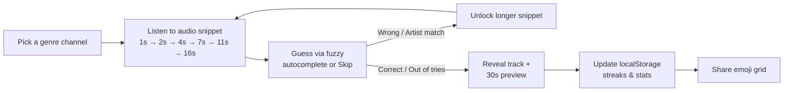
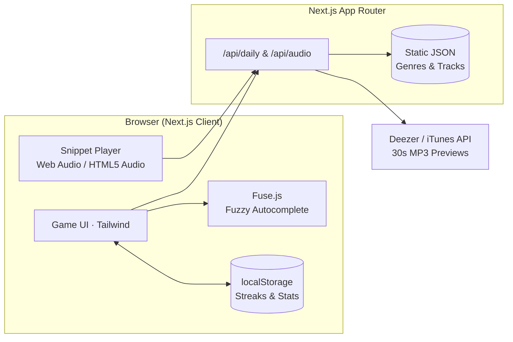

<div align="center">

# 🎧 Riffld

**The music guessing game for people whose favorite genre doesn't have a Billboard chart.**

Guess the track from a progressive audio snippet across reggaeton, hyperpop, corridos tumbados, amapiano, shoegaze, drift phonk, and dozens of other genres and subgenres.

[](https://nextjs.org)
[](https://www.typescriptlang.org)
[](https://tailwindcss.com)
[](#-roadmap)
[](#-contributing)

</div>

> [!NOTE]
> **Riffld** is a working title. This README is the project's design document and setup guide: it describes the target architecture before most of it is built.

---

## 📑 Table of Contents

- [Why Riffld?](#-why-riffld)
- [Core Loop](#-core-loop)
- [How It Works](#-how-it-works)
  - [Snippet Progression](#1-snippet-progression)
  - [Guess Feedback](#2-guess-feedback)
  - [Game Scopes: Daily & Infinite](#3-game-scopes)
- [Genre Taxonomy](#-genre-taxonomy)
- [Audio & Catalog Sourcing](#-audio--catalog-sourcing)
- [Architecture](#-architecture)
- [Tech Stack](#-tech-stack)
- [Data Model (Static JSON)](#-data-model-static-json)
- [Getting Started](#-getting-started)
- [Environment Variables](#-environment-variables)
- [Project Structure](#-project-structure)
- [Scripts](#-scripts)
- [Contributing](#-contributing)
- [Roadmap](#-roadmap)
- [Legal & Licensing Notes](#%EF%B8%8F-legal--licensing-notes)

---

## 💡 Why Riffld?

Heardle and Songdle are fun, but most of their libraries come from the mainstream: Billboard pop, classic rock, and chart hip-hop. If you grew up on Bad Bunny deep cuts, Midwest emo, or 3 a.m. breakcore, there's nothing in them for you.

Riffld is a **Songdle clone built around genre depth**:

| | Typical music guessers | **Riffld** |
|---|---|---|
| Catalog | Global top charts | Curated per **genre & subgenre** channel |
| Taxonomy | Flat ("Pop", "Rock") | 3-tier tree: **Root → Subgenre → Micro-genre** |
| Feedback | ❌ / ✅ | ❌ Wrong · 🟨 **Right artist, wrong track** · 🟩 Correct |
| Setup | Heavy backend | Zero-DB static JSON catalog + `localStorage` stats |

---

## 🔁 Core Loop



1. **Pick a genre**: choose from broad root genres or drill down into specific subgenres/micro-genres.
2. **Listen**: play a short snippet of the song.
3. **Guess or skip**: search the genre's track pool with typo-tolerant autocomplete. Every wrong guess or skip unlocks more audio.
4. **Share**: track your per-genre streaks locally and share your spoiler-free emoji results.

---

## 🎮 How It Works

### 1. Snippet Progression

Following the classic Heardle / Songdle formula, each wrong guess or skip unlocks more of the track:

| Attempt | 1 | 2 | 3 | 4 | 5 | 6 |
|---|---|---|---|---|---|---|
| **Audio revealed** | 1s | 2s | 4s | 7s | 11s | 16s |

- Playback uses the Web Audio API / HTML5 Audio to slice 30-second preview streams accurately.
- Each track can optionally define a `snippetOffsetMs` so songs with silent or ambient intros start right where the beat or hook drops.

### 2. Guess Feedback

| Indicator | Meaning |
|---|---|
| 🟩 **Correct** | Exact song match — round won! |
| 🟨 **Close** | Correct artist, wrong song |
| 🟥 **Wrong** | Incorrect artist and song |
| ⬜ **Skipped** | Skipped attempt to unlock more audio |

### 3. Game Scopes

#### 📅 Daily Mode
- **One synchronized puzzle per genre channel per day**, rolling over at 00:00 UTC.
- The daily track is selected deterministically from the genre's JSON catalog using `hash(channelId + YYYY-MM-DD + DAILY_SEED_SALT)`, so every player gets the exact same song without needing a database.
- **Shareable emoji grid**, spoiler-free:

  ```text
  Riffld #142 · 🇵🇷 Reggaeton · 3/6
  ⬜🟨🟩⬛⬛⬛
  🔥 Streak: 12
  riffld.app/daily/reggaeton
  ```

#### ♾️ Infinite / Practice Mode
- Endless random rounds in any genre or subgenre channel.
- Great for practicing niche subgenres or binge-playing when you finish the daily puzzle.

---

## 🧬 Genre Taxonomy

Genres form a **three-level tree**. Every track belongs to a primary micro-genre (which automatically rolls up into its parent subgenre and root genre channels).

```text
Root Genre
└── Subgenre
    └── Micro-genre
```

### Launch taxonomy (v1)

| Root | Subgenres / micro-genres |
|---|---|
| 🌎 **Latin** | Reggaeton · Latin Trap · Bachata · Salsa · Cumbia · Corridos Tumbados · Baile Funk |
| 🎛️ **Electronic & Underground** | Hyperpop · Glitchcore · Breakcore · Vaporwave · Future Funk · Drift Phonk · Ambient · UK Garage / 2-Step |
| 🎤 **Hip-Hop & R&B** | 90s East Coast · 90s West Coast · Trap · UK Drill · Boom Bap · Cloud Rap · Neo-Soul |
| 🎸 **Rock & Alternative** | Post-Punk · Midwest Emo · Shoegaze · Math Rock · Grunge · Metalcore |
| 🌐 **Global & Regional** | Afrobeats · Amapiano · City Pop · K-Pop · J-Rock |

### Taxonomy Schema

The genre hierarchy lives as version-controlled static JSON in [`src/data/genres/`](src/data/genres/).

```jsonc
// src/data/genres/latin.json
{
  "id": "latin",
  "name": "Latin",
  "emoji": "🌎",
  "children": [
    {
      "id": "latin.urbano",
      "name": "Urbano",
      "children": [
        {
          "id": "latin.urbano.reggaeton",
          "name": "Reggaeton",
          "aliases": ["reggaetón", "perreo", "dembow"]
        },
        {
          "id": "latin.urbano.latin-trap",
          "name": "Latin Trap",
          "aliases": ["trap latino"]
        }
      ]
    },
    {
      "id": "latin.regional-mexican",
      "name": "Regional Mexican",
      "children": [
        {
          "id": "latin.regional-mexican.corridos-tumbados",
          "name": "Corridos Tumbados",
          "aliases": ["corridos bélicos", "trap corridos"]
        }
      ]
    }
  ]
}
```

**Rules for adding a genre**
1. IDs are lowercase, kebab-case, dot-separated, and **never renamed** once shipped (since `localStorage` stats key off them). Use `aliases` for display/search synonyms.
2. A genre channel needs **at least 30 curated tracks** before it is enabled for Daily Mode.

---

## 📥 Audio & Catalog Sourcing

Riffld keeps data management dead simple: **curated static JSON tracklists** paired with **on-demand 30-second audio previews** from public music APIs.

### Audio Previews

| Priority | Source | Notes |
|---|---|---|
| 1 | **Deezer API** | Free, public 30s MP3 `preview` URLs with no auth required. Primary audio source. |
| 2 | **iTunes / Apple Music Search API** | Free, unauthenticated 30s M4A `previewUrl` and artwork fallback. |

Because preview URLs from providers like Deezer are signed and expire after a few hours, the static JSON catalog stores only the **provider track ID** (plus song title and artist). When a round starts, Next.js resolves a fresh preview URL via `/api/audio/[trackId]`.

### Building the Catalog

A lightweight CLI script (`npm run catalog:add`) lets you seed or expand a genre's JSON file by searching Deezer/iTunes by playlist, artist, or track name and writing the normalized metadata directly to `src/data/tracks/<genre>.json`.

---

## 🏗️ Architecture



**Key design decisions**

| Decision | Rationale |
|---|---|
| **Zero database (Static JSON)** | A few thousand tracks across dozens of genres easily fit in a few hundred kilobytes of JSON. No Postgres, Prisma, or Docker required. |
| **Client-side `localStorage` for stats** | Just like Wordle and Songdle, streaks and play history live in the browser—no login wall or auth complexity. |
| **Deterministic daily seed** | Daily tracks are chosen via a hashed date + salt on the server, requiring zero state persistence. |
| **Fuse.js for search** | Autocomplete searches only the active genre's track list, making client-side fuzzy matching instantaneous. |

---

## 🧰 Tech Stack

| Layer | Choice |
|---|---|
| **Framework** | [Next.js](https://nextjs.org) (App Router) + React + **TypeScript** (strict) |
| **Styling / UI** | [Tailwind CSS](https://tailwindcss.com), [Lucide Icons](https://lucide.dev) |
| **Audio** | Web Audio API / HTML5 `<audio>` for precise snippet cutoffs |
| **Data Storage** | Static JSON files (`src/data/`) + browser `localStorage` |
| **Search** | [Fuse.js](https://www.fusejs.io) for typo-tolerant artist + title autocomplete |
| **Testing** | Vitest (unit) |
| **Tooling** | ESLint, Prettier |

---

## 🗄️ Data Model (Static JSON)

All data is typed in [`src/types/`](src/types/) and stored in [`src/data/`](src/data/).

```ts
// src/types/catalog.ts
export interface GenreNode {
  id: string;        // e.g. "latin.urbano.reggaeton"
  name: string;      // e.g. "Reggaeton"
  emoji?: string;
  aliases?: string[];
  children?: GenreNode[];
}

export interface Track {
  id: string;               // internal unique slug, e.g. "bad-bunny-safaera"
  title: string;            // "Safaera"
  artist: string;           // "Bad Bunny"
  genreId: string;          // "latin.urbano.reggaeton"
  provider: "deezer" | "itunes";
  providerTrackId: string;  // e.g. "908604612"
  snippetOffsetMs?: number; // optional start offset (default 0)
}

export interface LocalGenreStats {
  gamesPlayed: number;
  wins: number;
  currentStreak: number;
  maxStreak: number;
  guessDistribution: [number, number, number, number, number, number]; // tries 1-6
  lastPlayedDate?: string; // "YYYY-MM-DD"
}
```

---

## 🚀 Getting Started

### Prerequisites

- **Node.js** ≥ 20 LTS
- **npm** ≥ 10 (or pnpm / yarn)

No database, Docker containers, or API keys are required to run the project!

### Local setup

**1. Clone and install**

```bash
git clone https://github.com/<your-org>/riffld.git
cd riffld
npm install
```

**2. Configure environment**

```bash
cp .env.example .env.local
```

**3. Start the dev server**

```bash
npm run dev
```

Open <http://localhost:3000> to play.

---

## 🔐 Environment Variables

Copy `.env.example` → `.env.local`.

| Variable | Required | Scope | Description |
|---|---|---|---|
| `NEXT_PUBLIC_APP_URL` | ✅ | client + server | Public base URL (e.g. `http://localhost:3000`), used in share text |
| `DAILY_SEED_SALT` | ✅ | server | Random string mixed into the daily hash so future answers can't be trivially guessed |

```dotenv
# .env.example
NEXT_PUBLIC_APP_URL="http://localhost:3000"
DAILY_SEED_SALT="change-me-in-production"
```

---

## 📂 Project Structure

```text
riffld/
├── scripts/
│   └── catalog.ts               # CLI helper to fetch Deezer/iTunes tracks into JSON
├── src/
│   ├── app/                     # Next.js App Router
│   │   ├── page.tsx             # Home / Genre picker
│   │   ├── daily/[genre]/       # Daily challenge for a genre channel
│   │   ├── play/[genre]/        # Infinite practice mode for a genre channel
│   │   └── api/
│   │       ├── audio/[trackId]/ # Resolves fresh 30s preview URL from Deezer/iTunes
│   │       └── daily/[genre]/   # Returns today's puzzle metadata & validates guesses
│   ├── components/
│   │   ├── game/                # SnippetPlayer, GuessInput, GuessList, ResultModal
│   │   ├── genre/               # GenrePicker, SubgenreDrawer
│   │   └── ui/                  # Shared UI primitives
│   ├── data/
│   │   ├── genres/              # 🧬 Genre taxonomy JSON files
│   │   └── tracks/              # 🎵 Curated track catalogs per genre (.json)
│   ├── hooks/                   # useAudioSnippet, useGameState, useLocalStats
│   ├── lib/
│   │   ├── server/
│   │   │   ├── daily.ts         # Server-only deterministic daily track selector & tokens
│   │   │   └── providers.ts     # Server-only Deezer & iTunes preview URL resolvers
│   │   ├── catalog.ts           # Helpers to load & filter static JSON genres/tracks
│   │   ├── feedback.ts          # Guess comparison (exact / artist match / wrong)
│   │   └── share.ts             # UTC date, puzzle number & spoiler-free share formatter
│   └── types/                   # TypeScript interfaces (GenreNode, Track, LocalGenreStats)
├── tests/                       # Vitest unit tests for game logic & catalog integrity
├── .env.example
└── README.md
```

---

## 📜 Scripts

| Command | What it does |
|---|---|
| `npm run dev` | Start Next.js development server on `:3000` |
| `npm run build` | Build for production |
| `npm run start` | Start production server |
| `npm run lint` | Run ESLint |
| `npm run typecheck` | Run `tsc --noEmit` |
| `npm run test` | Run Vitest unit tests (including JSON catalog validation) |
| `npm run catalog:add` | Interactive CLI to search Deezer/iTunes and append tracks to `src/data/tracks/` |

---

## 🤝 Contributing

Contributions are welcome—especially **genre & subgenre track curation**! Adding a new subgenre or expanding an existing one is just a JSON pull request.

### Genre / Catalog PR Checklist

- [ ] Genre node follows the `root.sub.micro` ID convention in `src/data/genres/`
- [ ] Track entries in `src/data/tracks/` have valid Deezer or iTunes track IDs
- [ ] At least 30 tracks for a micro-genre to qualify for Daily Mode
- [ ] `npm run test` passes (validates JSON schema and checks for duplicate tracks)

---

## 🗺️ Roadmap

### v0.1: Foundations
- [x] Next.js + TypeScript + Tailwind scaffold
- [ ] Genre taxonomy JSON + initial seed tracks
- [ ] Deezer / iTunes preview resolver endpoint (`/api/audio/[trackId]`)

### v1.0: MVP 🎯
- [ ] **Classic Snippet Mode** (`1s / 2s / 4s / 7s / 11s / 16s`)
- [ ] **Fuse.js** autocomplete with artist/song feedback (🟩 / 🟨 / 🟥 / ⬜)
- [ ] **Daily Mode** & **Infinite Mode** across launch genres and subgenres
- [ ] **`localStorage` stats & streaks** + shareable emoji grid

### v1.5: Polish & Expansion
- [ ] Expand catalog to 50+ micro-genres via community PRs
- [ ] Custom era filters in Infinite Mode (e.g., *90s*, *2000s*, *2020s*)
- [ ] Audio visualizer & mobile PWA polish

---

## ⚖️ Legal & Licensing Notes

- Riffld streams **only short official 30-second previews** provided by public APIs (Deezer, Apple Music/iTunes) and links out to the full track on those platforms. It never hosts or redistributes audio files.
- Riffld isn't affiliated with Heardle, Songdle, Deezer, Apple Music, or any artist featured in the game.

---

<div align="center">

**Made with 🎧 by people who have strong opinions about subgenres.**

[Report a bug](../../issues/new?labels=bug) · [Request a genre](../../issues/new?labels=genre) · [Start a discussion](../../discussions)

</div>
